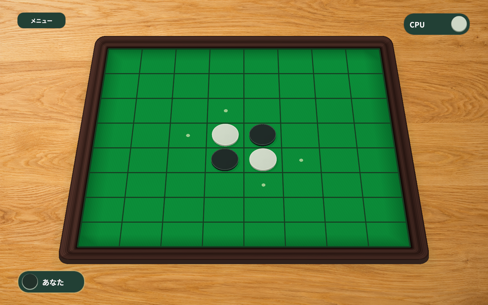
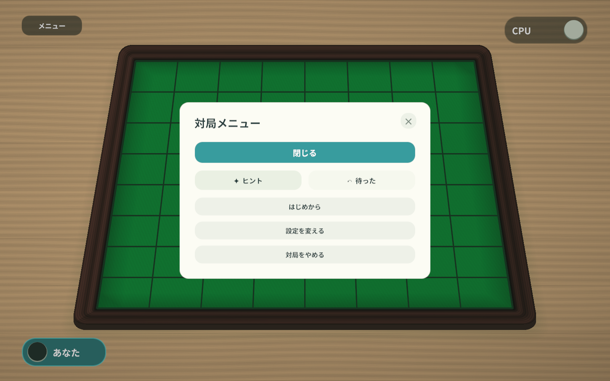

# 検証記録

- 実施日: **2026年11月18日**（日本時間）
- Unity: **6000.6.9f1**
- 対象シーン: `Assets/Scenes/Reversi.unity`

## 現在の画面

起動時は「あそび選択」を表示し、**リバーシ → リバーシについて・対戦設定 → 対局**の順に進みます。選択画面は短いプレイ映像、設定画面は終局までの要所をまとめた映像と、それに同期するルール説明を表示します。

対局中は床と盤面、左下・右上のプレイヤー名とコマの色のアイコンを表示します。「黒」「白」の文字は表示せず、常時表示の「メニュー」ボタンから対局の終了・メニューを閉じる操作ができます。Escと右クリックも使用できます。

## Playモードの統合検証

`Tabletop Reversi → Verify Navigation (Play Mode)`が、**90アサーション・5.78秒**で通過しました。

- 選択画面での着手を防ぎ、リバーシの選択・設定画面からの戻る操作・対局開始が動くこと。
- 自分のコマを白にするとCPUが黒で先手を打ち、白の手番へ移ること。
- 一時停止中はCPUと人間の着手が進まないこと。
- CPU対戦の「待った」が人間の直前の手番へ戻り、白を選んだ場合はCPUの初手を残すこと。
- 対局中の文字表示が2人分の名前と「メニュー」に限られ、名前は左下・右上に配置されること。
- メニューボタンが開き、「対局をやめる」「閉じる」が用意され、遊び方のダイアログ項目がないこと。
- CPUの応答待ちで選択画面へ戻っても、古い対局の処理が盤面を更新しないこと。
- ふたり対戦で1Pを白にしても黒の2Pが先手となり、手番交代と「待った」が動くこと。

## プレイ映像と同期説明の検証

`Tabletop Reversi → Verify Videos (Play Mode)`が、**259アサーション・2.35秒**で通過しました。

- 同梱した実際の動画をVideoPlayerでデコードし、描画先に盤面の画素が出力されること。
- 選択画面の短い映像が無音でループし、再生時刻が進むこと。
- 「リバーシについて」の説明文が、動画の再生時刻と章に同期すること。
- 中盤・終盤の章へ移動でき、終了場面では実際の最終枚数と勝敗を説明すること。
- 設定項目を変更して画面が再構築されても、映像の再生位置と一時停止状態を保持すること。
- 映像を再開でき、選択画面へ戻った後も短い映像を再生できること。
- 各画面で有効な動画デコーダーが1つに限られ、削除指定の文言が表示されないこと。

動画は本ゲームの盤面描画から作成したMP4です。どちらも**H.264・960×600・24fps**で、次の場所に同梱しています。

| 用途 | ファイル | 長さ |
| --- | --- | --- |
| あそび選択 | `Assets/Resources/Video/ReversiIntro.mp4` | 10秒 |
| リバーシについて | `Assets/Resources/Video/ReversiGuide.mp4` | 32秒 |

元になった対局は合法手で進めた60手の対局です。説明映像では中盤・終盤へ場面を進めながら最後まで見せ、**黒34枚・白30枚**の終局に到達します。タイムラインの最終盤面・枚数・説明文が一致し、その盤面がルール上も終局していることを確認しています。

## ルールと盤面描画

既存のルール検証は**5,546アサーション**を通過済みです。ランダム30対局とCPU同士の1対局を含み、8方向の反転、自動パス、終局、待った、CPUの合法手を確認しています。今回の変更でルール本体は変更していません。

盤面の全64マスの中心と四辺外側の入力判定、および64コマを配置した**44,805頂点**の描画も確認済みです。対局画面では描画と入力面を同じ比率で拡大しています。終局直前の局面から結果画面を表示し、「もう一度あそぶ」で初期盤面へ戻る動作も確認済みです。

## スクリーンショット

## macOSプレイヤー

動画全編の再生成と文言削除を含むMac版ビルドが成功しました。ビルド時間は7.02秒、出力サイズは86.49MB、エラー・警告はともに0件です。`Builds/Tabletop Reversi.app`と配布用ZIPを更新しています。

## 確認範囲

上記はUnityのPlayモードでの検証です。今回の変更に対するネイティブアプリ上での一連の手動操作、および人間がUIを操作して最後まで一対局を通す確認は含めていません。

場面転換は文字を表示せず、10秒・20秒の位置で短い暗転を挟みます。実際にデコードしたフレームで暗転前・暗転中・暗転後を確認し、切替中の説明文の非表示と再開後の復帰も確認しています。対局中の遊び方ダイアログは削除しています。

21.04〜21.58秒の旧カードが残っていた問題に対して、768フレームを空の出力先から全編再生成しました。再エンコード後の実動画で該当14フレームの文字消去と全編を確認し、21.3秒の実デコード描画にも旧カードがないことを検証しています。ホームの件数表示とメニューのEsc案内文も、実画面の文字一覧で非表示を確認しています。
