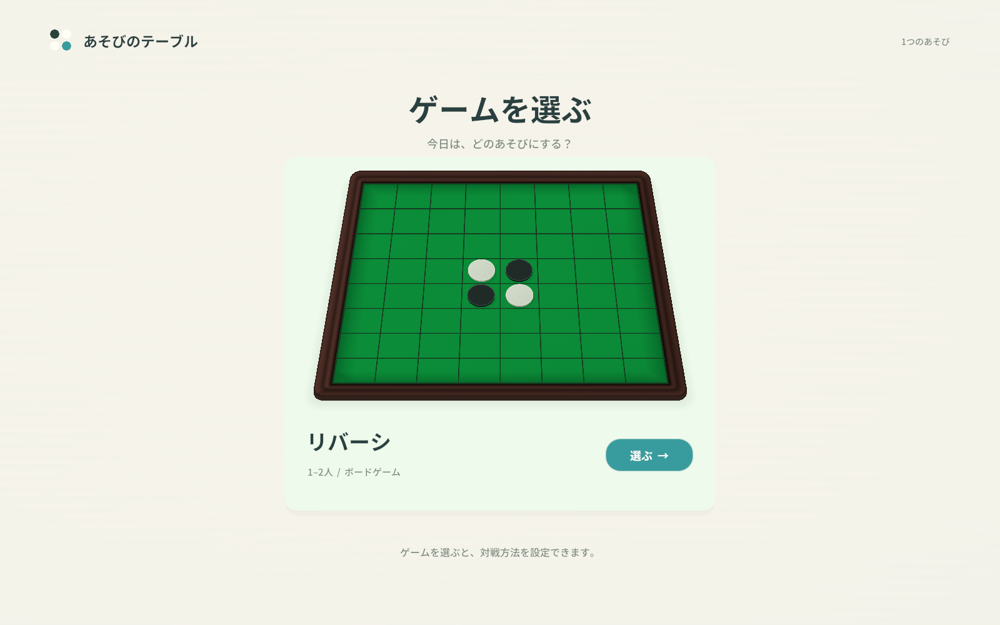
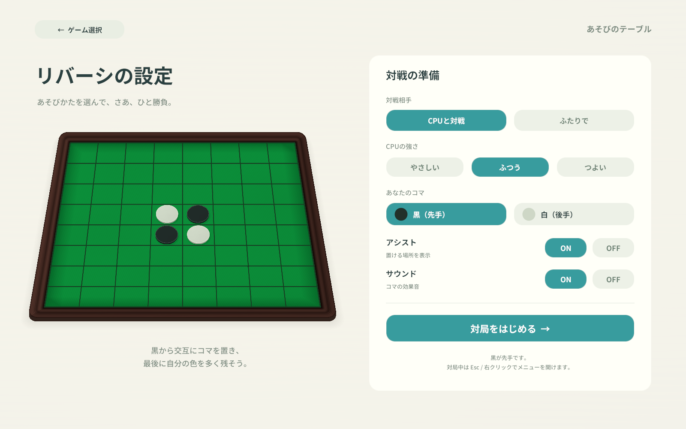
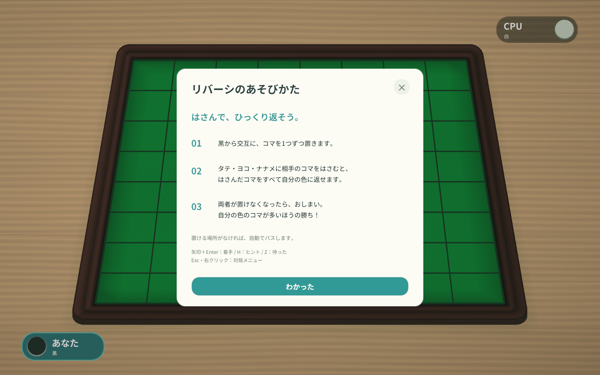

# 検証記録

- 実施日: **2026年11月18日**（日本時間）
- Unity: **6000.6.9f1**
- 対象シーン: `Assets/Scenes/Reversi.unity`

## 画面構成と遷移

起動時はゲーム選択画面を表示し、**リバーシ → 対戦設定 → 対局**の順に進みます。対局中の常時表示は盤面と木の床、左下・右上のプレイヤー名とコマの色です。対局メニューはEscまたは右クリックで開きます。

## Playモードの統合検証

`Tabletop Reversi → Verify Navigation (Play Mode)`の検証が、**73アサーション・5.79秒**で通過しました。ゲーム選択画面が表示されているPlayモードで実行し、完了後もゲーム選択画面へ戻ります。

- ゲーム選択中は着手できず、リバーシの選択で設定画面を開けること。
- 設定画面からゲーム選択へ戻り、開始ボタンで対局へ進めること。
- 「あなた」の色を白にするとCPUが黒で先手を打ち、白の手番へ移ること。
- 一時停止中はCPUの初手と人間の着手が進まず、右クリックでも着手せずにメニューを開けること。
- CPU対戦の「待った」が、人間の直前の手番へ戻ること。白を選んだ場合はCPUの初手を残すこと。
- 対局中の文字表示が2人分の名前とコマ色に限られ、左下・右上の指定位置に表示されること。
- CPUの応答待ちでゲーム選択へ戻っても、古い対局の処理が画面や盤面を更新しないこと。
- ふたり対戦で1Pを白にしても黒の2Pが先手となり、手番交代と「待った」が動作すること。

設定ボタンのコールバック経由でも、次の組み合わせを確認しています。

| 対戦方法 | 色・設定 | 確認した動作 |
| --- | --- | --- |
| ふたりで | 1Pが白、アシストOFF、サウンドOFF | 1P・2Pの名前と色、アシストOFFが対局へ反映される |
| CPUと対戦 | あなたが黒、CPUつよい、アシストON、サウンドON | CPU対戦の設定と難易度が対局へ反映される |

## ルールと盤面描画

ルールの自動検証は**5,546アサーション**を通過済みです。ランダム30対局とCPU同士の1対局を含み、8方向の反転、自動パス、終局、待った、CPUの合法手を確認しています。今回の画面変更でルール本体は変更していません。

質感更新時には、盤面のローカル座標で全64マスの中心から元の行・列へ戻る判定と、四辺の外側で入力を受け付けない判定が通過しています。全64マスにコマを配置した盤面描画は**44,805頂点**で、uGUIの65,000頂点制限以内です。対局画面では、この描画と入力面を同じ比率で拡大しています。

## 画面

## macOSプレイヤー

新しいゲーム選択・設定・対局画面を含むmacOS版ビルドが成功しました。ビルド時間は7.52秒、出力サイズは85.55MB、エラー・警告はともに0件です。

ローカル出力は`Builds/Tabletop Reversi.app`、配布用ZIPは`Builds/Tabletop-Reversi-macOS.zip`です。実行ファイルはGitHubへアップロードしていません。

## 確認範囲

人間がUIを操作して最後まで一対局を通す確認、およびネイティブアプリ上で矢印キーとEnterを使って着手する一連の操作は、この記録には含めていません。ルールの終局までの進行は上記の自動検証で確認しています。

## 終局と再対局

終局直前の合法局面から最後の着手で26対38の結果が表示され、「もう一度あそぶ」で0手目に戻ることを確認しました。
