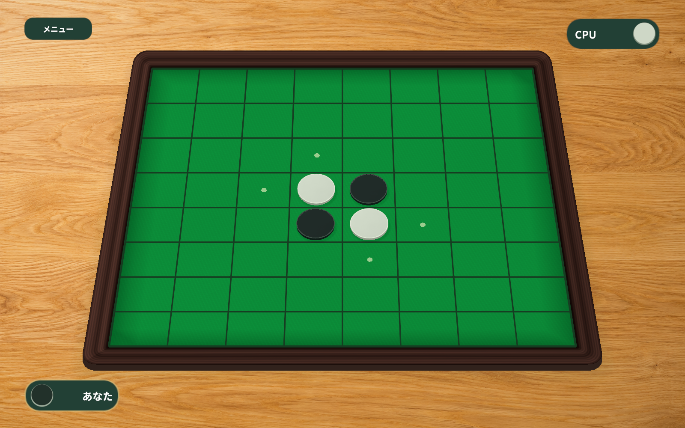

# あそび選択 / Tabletop Reversi

「あそび選択」からはじめる、Unity製のリバーシゲームです。短いプレイ映像でゲームを選び、「リバーシについて」画面でルールを見ながら対戦方法を設定できます。対局中はサテン仕上げのオーク材の机と盤面を大きく表示し、黒とアイボリーのマットなコマでCPU対戦やふたり対戦を楽しめます。

## 遊べること

- あそび選択 → リバーシについて → 対局の画面遷移（現在の収録ゲームはリバーシのみ）
- 選択カードで10秒のプレイ映像をループ再生
- 32秒のルール映像と、場面に連動して変わる説明文
- 3段階の強さから選べるCPU対戦
- 自分のコマを黒・白から選択
- 同じ端末で交互に操作する、ふたり対戦
- 置ける場所の表示とヒント
- まった、初めからやり直し
- 濃い青緑とグレー、白文字を使った読みやすい設定ボタン
- コマの効果音の切り替え
- マウスとキーボードによる操作

## 起動する

1. Unity Hubから、このフォルダをプロジェクトとして開きます。
2. **Unity 6000.6.9f1**で開き、パッケージの解決とインポートが完了するまで待ちます。
3. `Assets/Scenes/Reversi.unity`を開きます。
4. エディター上部の再生ボタンを押します。

シーンを作り直す場合は、メニューの **Tabletop Reversi → Create Game Scene** を実行します。シーンへの独自の変更がある場合は、先に保存・バックアップしてください。

## あそびはじめる

1. 「あそび選択」で、プレイ映像のある「リバーシ」のカードを選びます。
2. 「リバーシについて」でルール映像を見ながら、対戦相手、コマの色、「駒を置ける場所を表示」「コマの効果音」を選びます。CPU対戦では強さも選べます。ふたり対戦ではCPUの強さを表示せず、設定パネルをコンパクトにまとめます。
3. 「対局をはじめる」を押すと対局画面へ進みます。

[あそび選択画面](Documentation/game-selection.png) / [リバーシについて](Documentation/settings.png)

黒が先手です。CPU対戦で自分のコマを白にした場合は、黒のCPUからはじまります。

ルールは対局前の「リバーシについて」の映像で説明します。合法な1対局から、はじめかた、コマの返し方、はさめる方向、終盤、結果の5つの場面を見せ、再生位置に合わせて簡単な説明文が切り替わります。途中2か所は短い暗転で場面を切り替えて終局まで進みます。「前の場面」「次の場面」で章を移動でき、対戦設定を変えても再生位置を引き継ぎます。

対局画面は木の机と盤面を中心に、左下に「あなた」、右上に「CPU」をコマの色のアイコンと並べて表示します。ふたり対戦では「1P」「2P」になり、対局中のプレイヤー表示には「黒」「白」の文字を置きません。ふたり対戦では、画面上部の中央にコマの色のアイコンと「の番です」を表示し、手番を知らせます。CPU対戦と対局終了時には表示しません。「メニュー」には「まった」「初めから」「対局をやめる」の3項目と、右上の「×」を配置しています。

## 操作

| 操作 | 入力 |
| --- | --- |
| 石を置く | 置けるマスをクリック |
| マスの選択を移動 | 矢印キー |
| 選択したマスに置く | Enter |
| 対局メニューを開く | 「メニュー」ボタン、Esc、または盤面・机を右クリック |
| ヒント | H |
| まった | Z または対局メニューの「まった」 |
| 新しい対局 | R または対局メニューの「初めから」 |
| 対局を終了して選択画面へ戻る | 対局メニューの「対局をやめる」 |
| 開いているパネルを閉じる | 右上の「×」またはEsc |

黒が先手です。相手の石を自分の石ではさめるマスに置くと、その間の石が自分の色に変わります。置ける場所がないときはパスし、双方が置けなくなった時点で石の多い側が勝ちます。

## ビルドする

Unityの **File → Build Profiles** から対象プラットフォームを選び、`Assets/Scenes/Reversi.unity`をシーン一覧に含めてビルドします。生成先には、Git管理対象外の`Builds/`などを使用してください。

検証した内容と確認範囲は [Documentation/VERIFICATION.md](Documentation/VERIFICATION.md) に記録しています。

## プロジェクトについて

UIはUnity uGUIで構成し、画面構築を`ReversiGame.Interface.cs`、対局と画面遷移の管理を`ReversiGame.cs`に分けています。プレイ映像は実際の盤面描画を録画したMP4で、`ReversiReplayPlayer.cs`が再生時刻と説明文を同期します。盤面の斜めの織り目、丸い面取りの木枠、コマの控えめな光沢・側面・接地影は、独自の手続き生成テクスチャと描画で表現しています。机には画像生成ツールで作成したオリジナルのオーク材画像（`Assets/Resources/Materials/OakTabletop.png`）を使用し、`WoodenFloorGraphic.cs`で画面全体へ描画します。自然な木目、細かな導管、サテン仕上げの柔らかな光を表現した素材です。参考にした作品と素材の出典は [Documentation/REFERENCE.md](Documentation/REFERENCE.md) に記載しています。

ソースコードは[MIT License](LICENSE)です。同梱のNoto Sans JPフォントには [SIL Open Font License 1.1](Assets/Fonts/OFL.txt) が適用されます。Unityおよび各パッケージには、それぞれの利用条件が適用されます。

本プロジェクトは任天堂の公式作品ではなく、任天堂との提携・承認関係はありません。任天堂のロゴ、画像、音声などの素材は使用していません。
